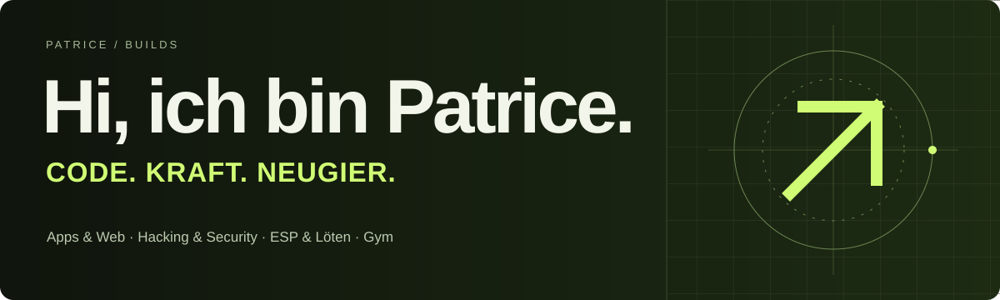

  

  <a href="https://der-programmer1.github.io/patrice-lab/"><strong>Mein Portfolio ↗</strong></a>
  &nbsp; · &nbsp;
  <a href="https://der-programmer1.github.io/AppShelf/"><strong>Apps ausprobieren ↗</strong></a>
  &nbsp; · &nbsp;
  <a href="stories/01-appshelf.md"><strong>Erste Projektgeschichte lesen</strong></a>

# Patrice / Builds

**Ideen ausprobieren. Dinge bauen. Fortschritt teilen.**

Ich bin **Patrice**. Ich entwickle Apps und Web-Projekte, beschäftige mich mit **Hacking und Security** und tüftle mit **ESP-Boards und Lötkolben**. Meinen Ausgleich finde ich im **Gym**, unter anderem beim Bankdrücken.

Hier erzähle ich, was hinter meinen Projekten steckt: die Idee, technische Entscheidungen, Versuche und Ergebnisse. Das Journal ergänzt mein [Portfolio](https://der-programmer1.github.io/patrice-lab/) um den Weg zum fertigen Stand.

## Steig dort ein, wo du neugierig bist

- **Du möchtest etwas ausprobieren?** Öffne [AppShelf](https://der-programmer1.github.io/AppShelf/) oder mein [Portfolio](https://der-programmer1.github.io/patrice-lab/).
- **Du interessierst dich für die Technik?** Die Projektberichte verlinken Architektur, Quellcode und Prüfungen.
- **Du möchtest verstehen, wie ich an Projekte herangehe?** Lies die Entscheidungen und Erkenntnisse in den Berichten.

## Im Journal

| Bericht | Worum es geht | Stand |
| --- | --- | --- |
| **[AppShelf: Ein Zuhause für meine Projekte](stories/01-appshelf.md)** | Vom Projektpaket über Vorschauen und Prüfungen bis zum veröffentlichten Katalog. | 11. November 2026 · Katalog öffentlich |
| **[Bananenblick: Was ein Modelltest sichtbar macht](stories/02-bananenblick.md)** | Lokale KI im Browser, nummerierte Erkennung und die Grenzen des getesteten Modellkandidaten. | 11. November 2026 · Prototyp, Update offen |

## Projekte zum Entdecken

| Projekt | Idee | Links |
| --- | --- | --- |
| **AppShelf** | Ein gemeinsamer Katalog für meine Apps, Demos und Downloads. | [Live](https://der-programmer1.github.io/AppShelf/) · [Code](https://github.com/der-programmer1/AppShelf) |
| **Bananenblick** | Bananenreife mit lokaler Bildauswertung im Browser erkunden. | [Öffentlicher Prototyp](https://der-programmer1.github.io/Bananenblick/) · [Code und Entwicklungsstand](https://github.com/der-programmer1/Bananenblick) |
| **Patrice / Lab** | Die Person und Interessen hinter dem Code. | [Portfolio](https://der-programmer1.github.io/patrice-lab/) · [Code](https://github.com/der-programmer1/patrice-lab) |

Aus Programmieren und Gym ist außerdem [GymDelay](https://der-programmer1.github.io/AppShelf/apps/gymdelay/) entstanden: ein Projekt rund um Musik und den Vorbereitungs-Countdown beim Training.

## Was mich antreibt

**Code & Apps.** Aus einer Idee etwas machen, das man öffnen und ausprobieren kann.

**Hacking & Security.** Systeme verstehen, Fragen stellen und in eigenen oder freigegebenen Umgebungen dazulernen.

**ESP & Löten.** Elektronik und Code zusammenbringen – mit kleinen Boards, echten Verbindungen und eigenen Versuchen.

**Gym & Bankdrücken.** Den Kopf frei bekommen, an mir arbeiten und dranbleiben.

## Wie ich meine Arbeit sichtbar mache

Die Berichte verbinden ein konkretes Ergebnis mit dem Weg dorthin. Quellcode, Screenshots und verlinkte Prüfungen machen den beschriebenen Stand nachvollziehbar. Bei Entwicklung und Dokumentation nutze ich auch KI-Unterstützung.

Bananenblick bleibt als Prototyp gekennzeichnet. Das neue Büschel-Update hat seine Modellziele noch nicht erreicht und benötigt echte Smartphone-Prüfungen. Mehr dazu steht im [Projektbericht](stories/02-bananenblick.md).

Für weitere Berichte gibt es eine [Buildlog-Vorlage](templates/buildlog.md). Zum Weitererzählen liegen [zwei AppShelf-Beitragstexte](sharing/app-shelf.md) bereit.

---

**Lust auf einen Austausch über ein Projekt, Code oder ESPs?** [Öffne ein Issue in diesem Journal](https://github.com/der-programmer1/patrice-builds/issues) oder sieh dir meine [Repositories](https://github.com/der-programmer1?tab=repositories) an.
