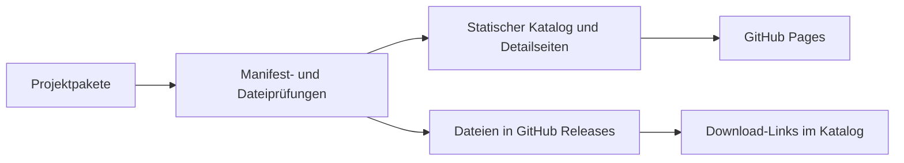

# AppShelf: Ein Zuhause für meine Projekte

**11. November 2026 · Web, Automatisierung und Veröffentlichung**

[Katalog ausprobieren ↗](https://der-programmer1.github.io/AppShelf/) · [Quellcode](https://github.com/der-programmer1/AppShelf) · [Zur Journal-Übersicht](../README.md)

## Die Idee

Meine Projekte bringen unterschiedliche Dinge mit: eine Web-Demo, eine Android-App, Screenshots oder ein Quellarchiv. AppShelf führt sie in einem gemeinsamen Katalog zusammen. Wer etwas entdeckt, soll schnell verstehen, worum es geht, eine Vorschau sehen und die passende Demo oder Datei finden.

Der veröffentlichte Katalog zeigt die Ergebnisse. Das Repository macht den Weg der Veröffentlichung nachvollziehbar.

## Ein Blick hinein

| Bananenblick · öffentlicher Prototyp | Aufbrauchen · Web-Ansicht |
| --- | --- |
|  |  |

Die Aufnahmen stammen aus dem öffentlichen AppShelf-Katalog. Bananenblick zeigt ein Beispielbild, keine Liveaufnahme. Bildquelle des Bananen-Beispiels: Rohit et al. (2026), CC BY 4.0, dokumentiert im [Bananenblick-Repository](https://github.com/der-programmer1/Bananenblick).

## Die technische Idee dahinter

Jedes Projektpaket liegt unter `apps/inbox/`. Ein `app.json` beschreibt unter anderem Name, Version, Plattform und Verweise. Beschreibung, Screenshots und verfügbare Dateien ergänzen das Paket.

Node.js und GitHub Actions übernehmen Build und Veröffentlichung. Der Katalog und seine Download-Steuerung funktionieren auch ohne JavaScript. APKs, AABs und Quellarchive werden aus GitHub Releases verlinkt.

## Drei Entscheidungen, die das Projekt prägen

| Entscheidung | Warum sie hier passt |
| --- | --- |
| **Statische Ausgabe** | Die Besucherseite lässt sich ohne eigenen Katalog-Server über GitHub Pages ausliefern. |
| **Projektmanifeste** | Unterschiedliche Apps bekommen eine gemeinsame Darstellung aus strukturierten Daten. |
| **Externe Web-Apps verlinken** | Ein schon veröffentlichtes Projekt kann im Katalog erscheinen, während es an seiner bestehenden Adresse bleibt. |

## Eine konkrete Überarbeitung

Die großen Screenshot-Flächen waren aus den Katalogkarten verschwunden. In [PR #17](https://github.com/der-programmer1/AppShelf/pull/17) wurden die Bildvorschauen, abgerundeten Karten und Kategorie-Badges wiederhergestellt. Die Bilder führen zu den Projektdetails; die Hauptaktion und das Optionsmenü bleiben bedienbar.

Dabei kam die bestehende öffentliche Bananenblick-Version 0.1.0 als Prototyp in den Katalog. Die Präsentation kennzeichnet ihren Entwicklungsstand. Das noch offene Büschel-Update wurde dadurch nicht veröffentlicht.

## Was sich daran nachvollziehen lässt

AppShelf verbindet Projektstruktur, Darstellung, Prüfungen und Veröffentlichung. Die [ausführliche Projektvorstellung](https://github.com/der-programmer1/AppShelf/blob/main/docs/projektgeschichte.md) erklärt weitere Entscheidungen. Die [Workflows](https://github.com/der-programmer1/AppShelf/actions) zeigen, welche Schritte auf welchem Stand ausgeführt wurden.

Die [Veröffentlichung vom 11. November 2026](https://github.com/der-programmer1/AppShelf/actions/runs/42974882388) gehört zum beschriebenen App-Stand. Die Dokumentations-Erweiterung wurde anschließend mit einem [erfolgreichen Workflow](https://github.com/der-programmer1/AppShelf/actions/runs/43092113365) veröffentlicht.

Für mich ist der nächste wertvolle Teil der Präsentation, auch diese Entscheidungen und Überarbeitungen zu zeigen. So wird aus einer Projektkarte eine Geschichte, deren Technik man nachlesen und ausprobieren kann.

---

[AppShelf öffnen ↗](https://der-programmer1.github.io/AppShelf/) · [Zurück zum Journal](../README.md)
